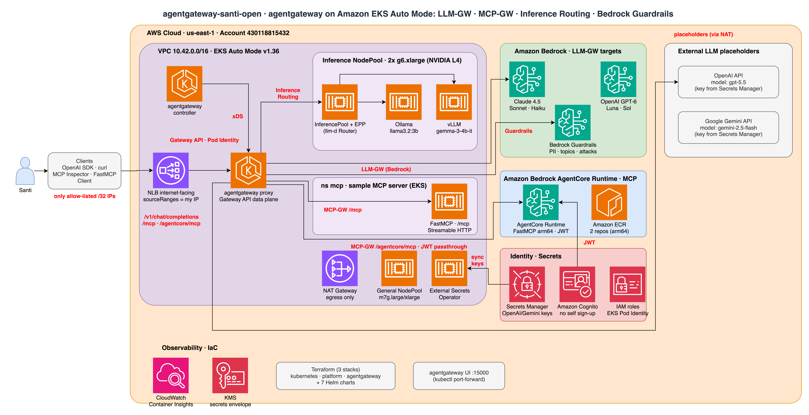
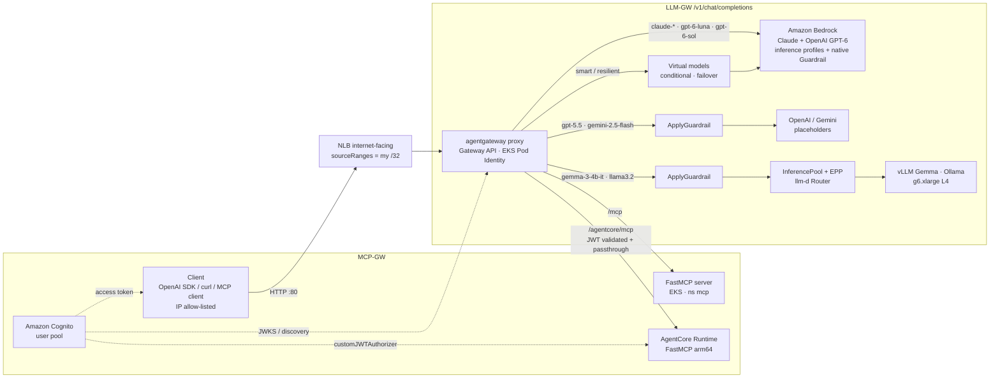
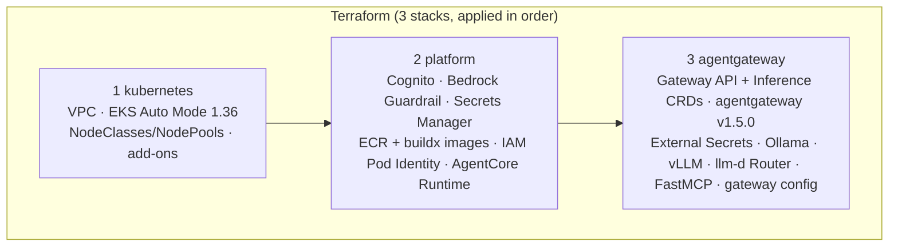

# agentgateway on Amazon EKS (Auto Mode) - LLM Gateway, MCP Gateway, Inference Routing and Bedrock Guardrails

[](LICENSE.md)
[](terraform/)
[](https://github.com/agentgateway/agentgateway)
[](https://docs.aws.amazon.com/eks/latest/userguide/automode.html)

Open-source, fully reproducible reference deployment of **[agentgateway](https://github.com/agentgateway/agentgateway)**
(the CNCF/AAIF agentic-AI data plane) on **Amazon EKS Auto Mode**, prioritizing AWS-native services:

| Capability | What is deployed | AWS services |
| --- | --- | --- |
| **LLM Gateway** | One OpenAI-compatible endpoint (`/v1/chat/completions`, `/v1/models`) routing by model name to Amazon Bedrock inference profiles (Claude Sonnet 4.5, Claude Haiku 4.5, OpenAI GPT-6 Luna, OpenAI GPT-6 Sol), virtual models (conditional + failover), and placeholders for OpenAI and Gemini | Amazon Bedrock, Secrets Manager |
| **MCP Gateway** | `/mcp` federates a FastMCP server running in EKS; `/agentcore/mcp` proxies an MCP server hosted on **Amazon Bedrock AgentCore Runtime** protected by **Cognito JWT** (demo user, self sign-up disabled) | AgentCore Runtime, Cognito, ECR |
| **Inference Routing** | Self-hosted **Ollama (`llama3.2:3b`)** and **Gemma 3 4B (vLLM)** on GPU nodes behind Gateway API `InferencePool`s with the llm-d Router endpoint picker | EKS Auto Mode GPU NodePool (g6.xlarge) |
| **Guardrails** | One **Amazon Bedrock Guardrail** (PII, denied topics, prompt attacks, profanity; strengths tunable via Terraform variables, auto-published versions) enforced natively on Bedrock models and through the ApplyGuardrail API on every other model | Amazon Bedrock Guardrails |

Everything is Terraform + Helm (remote state in S3 with native locking). Naming standard: `agentgateway-santi-open`. Network exposure: **only your IP** (`/32`).

## Architecture



Source: [`assets/agentgateway-santi-open-architecture.drawio`](assets/agentgateway-santi-open-architecture.drawio)
(generated by [`assets/generate_architecture_drawio.py`](assets/generate_architecture_drawio.py)).

### Request flows





## Repository layout

```text
.
├── README.md · MANUAL_STEPS.md · TESTING_INSTRUCTIONS.md · LICENSE.md
├── INDEX.html                       # interactive flow explorer for demos (open locally)
├── assets/                          # draw.io diagram (+ generator) and DPI-400 PNG
├── postman/                         # Postman collection (65 requests, tests + live examples), env template, generator
├── apps/
│   ├── fastmcp-eks/                 # FastMCP server for EKS (Streamable HTTP, arm64)
│   └── agentcore-mcp/               # FastMCP server for AgentCore Runtime (MCP protocol, arm64)
├── docs/
│   ├── STEP_BY_STEP.md              # deploy / validate / destroy runbook + troubleshooting
│   ├── VALIDATION_SCRIPT_MANUAL.md  # manual of validate_solution_scripts.sh
│   └── adr/                         # 14 Architecture Decision Records
├── scripts/
│   ├── validate_solution_scripts.sh # didactic validator (menu + CLI): LLM-GW, MCP-GW, routing, guardrails, security
│   ├── deploy-all.sh · destroy-all.sh · get-gateway-url.sh · cognito-token.sh · ui.sh (admin UI + metrics via port-forward)
│   ├── postman-env.sh               # writes the git-ignored Postman environment from the live deployment
│   ├── agents/                      # Strands Agents samples (interactive chat + DEMO banking tools)
│   │   ├── agent1.py                # Bedrock (Claude Haiku 4.5 default) through the gateway
│   │   ├── agent2.py                # self-hosted InferencePools (llama3.2 default, gemma-3-4b-it)
│   │   ├── tools_banco.py           # consulta_saldo, estado_canales, movimientos, tasa_cambio, bloquear_tarjeta, hora_colombia
│   │   └── common.py                # gateway URL, CLI args (--model/--tools), interactive loop
│   └── tests/                       # individual suites, FastMCP test client, test-postman.sh (Newman)
└── terraform/
    ├── kubernetes/                  # Stack 1: VPC + EKS Auto Mode + custom NodePools (local Helm chart)
    ├── platform/                    # Stack 2: AWS services around the cluster
    └── agentgateway/                # Stack 3: Helm releases (OCI + 7 local charts)
        └── charts/
            ├── gateway-api-crds/            # vendored Gateway API v1.6.0 (experimental channel)
            ├── inference-extension-crds/    # vendored Inference Extension v1.5.0
            ├── platform-secrets/            # ClusterSecretStore + ExternalSecrets
            ├── inference-ollama/            # Ollama on GPU
            ├── inference-gemma-vllm/        # vLLM + Gemma 3 4B on GPU
            ├── mcp-fastmcp/                 # MCP server Deployment/Service (appProtocol agentgateway.dev/mcp)
            └── agentgateway-config/         # Gateway, AgentgatewayParameters, Models, Backends, Routes, Policies
```

## Quickstart

```bash
# 0. prerequisites: terraform, aws cli v2, kubectl, helm, docker+buildx (colima), poetry, jq
poetry install --no-root
# 1. put YOUR public IP in terraform/kubernetes/terraform.tfvars (allowed_cidrs = ["x.x.x.x/32"])
# 2. deploy (≈35 min end to end)
./scripts/deploy-all.sh -auto-approve
# 3. validate (didactic menu; or: ./scripts/validate_solution_scripts.sh all)
./scripts/validate_solution_scripts.sh
#    ...or the Postman collection headless (65 requests, ~45 s): ./scripts/tests/test-postman.sh
# 4. destroy when done (≈USD 2.1/h while running)
./scripts/destroy-all.sh -auto-approve
```

Interactive walkthrough of every request type (open [INDEX.html](INDEX.html) in a browser, no server needed): animated architecture diagram plus step-by-step player for Bedrock, virtual models, placeholders, InferencePools, MCP on EKS, MCP on AgentCore with Cognito JWT, blocked requests and the Strands tool-calling loop.

Detailed runbook (deploy, validate, destroy, troubleshooting): [docs/STEP_BY_STEP.md](docs/STEP_BY_STEP.md).
Validator manual: [docs/VALIDATION_SCRIPT_MANUAL.md](docs/VALIDATION_SCRIPT_MANUAL.md). Expected results: [TESTING_INSTRUCTIONS.md](TESTING_INSTRUCTIONS.md).
Manual actions (only optional API keys): [MANUAL_STEPS.md](MANUAL_STEPS.md).

## Components and versions

| Component | Version | Source |
| --- | --- | --- |
| Amazon EKS Auto Mode | Kubernetes 1.36 (Bottlerocket, arm64 general pool, x86 GPU pool) | `terraform-aws-modules/eks` ~> 21.26 |
| agentgateway control plane + CRDs | v1.5.0 | `oci://cr.agentgateway.dev/charts` |
| Kubernetes Gateway API | v1.6.0 experimental channel | vendored |
| Gateway API Inference Extension | v1.5.0 | vendored |
| llm-d Router Gateway (InferencePool + EPP) | v0.9.0 | `oci://ghcr.io/llm-d/charts` |
| External Secrets Operator | 2.11.0 | `charts.external-secrets.io` |
| Ollama | 0.34.4 | Docker Hub |
| vLLM | v0.30.0 | Docker Hub |
| FastMCP (sample servers + test client) | >= 2.12 | PyPI |
| Terraform | >= 1.10 (tested 1.16.4), providers aws ~> 6.0, helm ~> 3.0 | `hashicorp/tap` |
| Terraform state | S3 `terraform-santigrc-430118815432` · keys `agentgateway-santi-open/<stack>/terraform.tfstate` · native S3 locking | ADR-002 |

## Model catalog (client-facing names)

| Name | Type | Target | Guardrail |
| --- | --- | --- | --- |
| `claude-sonnet-4-5` | Bedrock | `us.anthropic.claude-sonnet-4-5-20250929-v1:0` | native |
| `claude-haiku-4-5` | Bedrock | `global.anthropic.claude-haiku-4-5-20251001-v1:0` | native |
| `gpt-6-luna` | Bedrock (OpenAI, economical tier) | `us.openai.gpt-6-luna` · gateway drops `temperature`/`top_p`, reasoning effort `none` | native |
| `gpt-6-sol` | Bedrock (OpenAI, premium tier) | `us.openai.gpt-6-sol` · gateway drops `temperature`/`top_p`, reasoning effort `none` | native |
| `smart` | virtual conditional | `x-model-tier: premium` -> Claude Sonnet 4.5, else GPT-6 Luna | inherited |
| `resilient` | virtual failover | Claude Sonnet 4.5 -> GPT-6 Sol | inherited |
| `gpt-5.5` | OpenAI placeholder | key from Secrets Manager | ApplyGuardrail |
| `gemini-2.5-flash` | Gemini placeholder | key from Secrets Manager | ApplyGuardrail |
| `gemma-3-4b-it` | InferencePool `gemma` | vLLM on g6.xlarge | ApplyGuardrail |
| `llama3.2` | InferencePool `ollama` | Ollama `llama3.2:3b` on g6.xlarge | ApplyGuardrail |

## Invoking LLMs from your local scripts

The gateway is a plain **OpenAI-compatible** endpoint on HTTP port 80, reachable only from the
allow-listed IPs. Any client that can talk to OpenAI can talk to it: set `base_url` to `http://<NLB>/v1`,
pass any string as `api_key` (the gateway authenticates to Bedrock with Pod Identity), and use the
client-facing model name from the catalog. Bedrock models and open models are invoked **exactly the same way**;
only the `model` value changes.

```bash
export AGENTGATEWAY_URL=$(./scripts/get-gateway-url.sh)        # http://agentgateway-santi-open-nlb-....amazonaws.com
curl -s $AGENTGATEWAY_URL/v1/models | jq -r '.data[].id'         # discovery

# Bedrock (Claude Haiku 4.5, native guardrail)
curl -s $AGENTGATEWAY_URL/v1/chat/completions -H 'content-type: application/json' \
  -d '{"model":"claude-haiku-4-5","messages":[{"role":"user","content":"Hola parcero"}]}'
# Open model on the GPU nodes (Gemma 3 4B on vLLM, ApplyGuardrail prompt guard)
curl -s $AGENTGATEWAY_URL/v1/chat/completions -H 'content-type: application/json' \
  -d '{"model":"gemma-3-4b-it","messages":[{"role":"user","content":"Who are you?"}]}'
```

```python
# OpenAI SDK (poetry install --no-root provides it)
from openai import OpenAI
client = OpenAI(base_url=f"{AGENTGATEWAY_URL}/v1", api_key="not-needed")
client.chat.completions.create(model="llama3.2", messages=[{"role": "user", "content": "hi"}])
```

### Strands Agents samples (`scripts/agents/`)

Two interactive agents built with [Strands Agents](https://strandsagents.com) that use the gateway as an
OpenAI-compatible model provider (`OpenAIModel` with `base_url`). Without a prompt argument they open a chat
loop with conversation memory (type `salir` to exit); with a prompt they answer once. Both share a set of
**DEMO banking tools** (static data) in `tools_banco.py`, selectable per run:

| Tool | What it returns |
| --- | --- |
| `consulta_saldo(cuenta)` | balance of `ahorros-1234`, `corriente-5678`, `usd-9012` |
| `estado_canales(solo_incidentes)` | status/latency of app, web, ATMs, PSE, branches, ACH |
| `movimientos(cuenta, ultimos)` | last N transactions |
| `tasa_cambio(moneda, monto)` | DEMO FX rate to COP and conversion |
| `bloquear_tarjeta(tarjeta, motivo)` | DEMO card block by alias (`visa-principal`, `mastercard-viajes`, `debito-ahorros`) with a ticket id |
| `hora_colombia()` | current time in Colombia |

| Script | Default model | Notes |
| --- | --- | --- |
| `agent1.py` | `claude-haiku-4-5` (Bedrock) | Spanish banking system prompt; tool-call round trip translated OpenAI <-> Bedrock by agentgateway. `--model gpt-6-luna`, `gpt-6-sol`, `smart`, `resilient`... |
| `agent2.py` | `llama3.2` (Ollama InferencePool) | No system prompt (see gotchas). `--model gemma-3-4b-it --tools none`: the vLLM deployment has no tool parser and answers 400 `"auto" tool choice requires --enable-auto-tool-choice` when tools are sent |

```bash
poetry install --no-root                                   # installs strands-agents[openai]
export AGENTGATEWAY_URL=$(./scripts/get-gateway-url.sh)   # optional: the scripts fall back to kubectl
.venv/bin/python scripts/agents/agent1.py                                        # interactive, all tools
.venv/bin/python scripts/agents/agent1.py "Saldo de ahorros-1234 y canales con incidentes?"
.venv/bin/python scripts/agents/agent1.py --tools consulta-saldo,estado-canales   # subset (dash or underscore)
.venv/bin/python scripts/agents/agent2.py "Que canales estan degradados?"         # llama3.2 + tools
.venv/bin/python scripts/agents/agent2.py --model gemma-3-4b-it --tools none "Who are you?"
```

Gotchas found while wiring Strands to the gateway (all handled in the samples):

- Strands always sends `"tools": []`. Bedrock rejects an empty tool list with HTTP 400 `The provided request is not valid`;
  `common.GatewayOpenAIModel` drops the key when the agent has no tools (`--tools none`).
- OpenAI GPT-6 Luna/Sol on Bedrock answer `ValidationException: This model doesn't support the temperature field`
  (same for `topP`). The samples send `temperature=0.2`, so the gateway fixes it for every client: the
  `dropParams` list of each Bedrock model sets `temperature`/`top_p` to `null` (CEL `transformations`) before the
  OpenAI -> Converse translation. Claude keeps honoring both parameters.
- When GPT-6 reasons (default effort, and even `low` on harder prompts) Bedrock returns the encrypted reasoning as
  `reasoningContent.redactedContent`, and agentgateway v1.5.0 fails with `failed to parse response: data did not
  match any variant of untagged enum ReasoningContentBlock`. `openaiReasoningEffort: none` injects
  `additionalModelRequestFields.reasoning.effort = "none"` after the translation (`finalTransformations`), so no
  reasoning block comes back (also faster and cheaper: 13 instead of 81 output tokens for a one-line answer). The
  upstream fix is agentgateway v1.6.0 (non-streaming) and v1.7.0 (streaming); after upgrading, raise the effort
  per model in `bedrock_models`.
- On non-Bedrock models the guardrail runs through ApplyGuardrail on the raw text (system prompt included), and the
  `PROMPT_ATTACK` classifier scores English system-prompt-like text such as "You are a concise assistant." as a HIGH
  confidence attack, so it is blocked even at MEDIUM strength (HTTP 403); a Spanish banking system prompt scores MEDIUM
  confidence once combined with the user turn and is blocked too. agent2 therefore has no system prompt; set
  `guardrail_prompt_attack_strength = "LOW"` if you want system prompts on self-hosted models. Bedrock models (agent1)
  accept system prompts normally because Bedrock does not evaluate the system field as a prompt attack.
- Guardrail strength matters more than it looks: HIGH blocks even LOW-confidence matches, and on Converse the native
  guardrail evaluates the **whole conversation**. With everything at HIGH (version 1), benign follow-ups such as
  "consultar saldo" were blocked once the chat history mentioned "robo/fraude". Version 2 uses MEDIUM content filters,
  MISCONDUCT LOW and card numbers ANONYMIZE; tune with `guardrail_*_strength` in `terraform/platform/terraform.tfvars`
  (every change publishes a new version and stack 3 picks it up). `bloquear_tarjeta` still identifies cards by alias,
  which keeps card digits out of the conversation altogether.

## Postman collection (`postman/`)

A Postman collection doubles as an API tour and as a test suite: **65 requests in 10 folders**
(Discovery, Bedrock Claude, Bedrock OpenAI GPT-6, virtual models, inference routing, external
placeholders, guardrails, MCP on EKS, AgentCore + Cognito JWT, observability). Each request explains what
it validates and the expected result, runs `pm.test` assertions and includes a saved example captured
from a live run. Names follow `<AREA>-<NN> · <target> · <scenario> → <expected>`, for example
`GRD-09 · gemma-3-4b-it · PII email → 403 prompt guard`.

```bash
./scripts/postman-env.sh                              # local environment from the live deployment (git-ignored)
# Postman: import postman/*.postman_collection.json + postman/*.local.postman_environment.json, fill cognitoPassword
./scripts/tests/test-postman.sh                       # headless with Newman: 65 requests, 295 assertions
WITH_OBSERVABILITY=1 ./scripts/tests/test-postman.sh  # + admin UI / config_dump / metrics via port-forward
```

Details, diagrams and the naming convention: [postman/README.md](postman/README.md).

## Observability: agentgateway UI, metrics and logs

The proxy ships a read-only admin UI (listeners, routes, backends, policies, config dump) on port 15000 and a
Prometheus endpoint on port 15020. Neither is exposed on the NLB (ADR-013); reach both through a port-forward:

```bash
./scripts/ui.sh                       # opens http://localhost:15000/ui/ and forwards :15020/metrics
curl -s localhost:15020/metrics | grep agentgateway_gen_ai_client_token_usage_sum
```

Per-request data also lands in CloudWatch without extra components: the proxy's JSON access logs
(`gen_ai.request.model`, `gen_ai.usage.*_tokens`, `agw.ai.time_to_first_token`, `http.status`) go to the Container
Insights log group `/aws/containerinsights/agentgateway-santi-open-eks/application`, and the guardrail publishes
`Invocations`, `InvocationsIntervened`, `TextUnitCount` and `InvocationLatency` in the `AWS/Bedrock/Guardrails` namespace.
Example Logs Insights query (tokens and TTFT per model):

```sql
fields @timestamp, `http.status`, `gen_ai.request.model`, `gen_ai.usage.input_tokens`, `gen_ai.usage.output_tokens`
| filter `protocol` = "llm"
| stats count() as requests, sum(`gen_ai.usage.input_tokens`) as tokens_in,
        sum(`gen_ai.usage.output_tokens`) as tokens_out, avg(`agw.ai.time_to_first_token`) as ttft_avg
  by `gen_ai.request.model`
```

## Security posture

- EKS API endpoint public access limited to `allowed_cidrs` (validation forbids `0.0.0.0/0`), private endpoint on.
- NLB `loadBalancerSourceRanges` = your `/32`; nodes in private subnets; egress via NAT; VPC flow logs.
- No static AWS credentials: EKS Pod Identity roles with least-privilege policies (Bedrock invoke on
  foundation models/inference profiles, `ApplyGuardrail` on one guardrail, `InvokeAgentRuntime` on one runtime).
- Third-party keys only in Secrets Manager (placeholders) synced by External Secrets; never in git or state.
- Cognito: admin-only user creation, strong password policy, access tokens validated by agentgateway (issuer,
  JWKS, `client_id`, `token_use`) and again by AgentCore.
- Kubernetes secrets envelope-encrypted with KMS; control-plane audit logs on; containers run as non-root,
  read-only root filesystem, no capabilities.

## Cost (us-east-1, on-demand, approximate)

| Item | USD/hour |
| --- | --- |
| 2x g6.xlarge (Ollama + Gemma) | 1.61 |
| 2x m7g.large (general) + system node | ~0.25 |
| EKS control plane | 0.10 |
| NAT gateway + Auto Mode fee + NLB | ~0.15 |
| **Total** | **~2.1 (~50/day)** |

Set `enable_inference_routing = false` to drop the GPU nodes when you only need Bedrock/MCP.

## Decisions

All decisions are documented as ADRs in [docs/adr](docs/adr/README.md): EKS Auto Mode, three-stack
Terraform layout, agentgateway Kubernetes mode with the model-centric API, medium-tier instances,
IP allow-list exposure, Pod Identity, guardrails strategy, inference routing, Gemma weights source,
secrets management, AgentCore JWT passthrough, image pipeline, observability and the model catalog.

## Validation results

Run executed on 2026-11-26 from the allow-listed IP against
`agentgateway-santi-open-nlb-<hash>.elb.us-east-1.amazonaws.com` (HTTP :80), right after a redeploy from zero
(`./scripts/deploy-all.sh -auto-approve`: 73 + 26 + 12 = 111 resources in ~35 min, state in S3). Full commands in
[TESTING_INSTRUCTIONS.md](TESTING_INSTRUCTIONS.md); raw suites live in `scripts/tests/` (`run-all-tests.sh`: 0 failures).

| # | Capability | Check | Result |
| --- | --- | --- | --- |
| 1 | LLM-GW | `/v1/models` lists the 10 client-facing models | PASS |
| 2 | LLM-GW | Bedrock routing `claude-sonnet-4-5`, `claude-haiku-4-5`, `gpt-6-luna`, `gpt-6-sol` (Pod Identity, no keys) | PASS - OpenAI-shaped responses with token usage |
| 3 | LLM-GW | `gpt-6-luna` and `smart` with `temperature=0.2` + `top_p=0.9` (Bedrock alone answers 400) | PASS - nulled by the gateway (`dropParams`) |
| 4 | LLM-GW | Virtual `smart`: default -> `us.openai.gpt-6-luna`; header `x-model-tier: premium` -> `us.anthropic.claude-sonnet-4-5-20250929-v1:0` | PASS |
| 5 | LLM-GW | Virtual `resilient` (failover) served by the priority-0 target (Claude Sonnet 4.5) | PASS |
| 6 | LLM-GW | SSE streaming through the gateway | PASS |
| 7 | LLM-GW | Placeholders `gpt-5.5` / `gemini-2.5-flash` reach the provider and fail with `invalid_api_key` / `authentication_error` (placeholder value) | PASS (expected until MANUAL_STEPS) |
| 8 | Guardrails | Bedrock-native: PII email, denied topic, prompt attack, profanity, custom word blocked on Claude Haiku 4.5 and GPT-6 Luna; benign control passes | PASS |
| 9 | Guardrails | ApplyGuardrail prompt guard on `gemma-3-4b-it` and `gpt-5.5`: HTTP 403 with custom message, before any upstream call | PASS |
| 10 | Agents | Strands `agent1.py --model gpt-6-sol`: streaming, Spanish system prompt, 2 tool calls (`consulta_saldo`, `estado_canales`) | PASS |
| 11 | MCP-GW | `/mcp` -> FastMCP on EKS: initialize, tools/list (4 tools), `eks_add` = 42, `eks_runtime_info` shows pod on Graviton (`aarch64`) | PASS |
| 12 | MCP-GW | `/agentcore/mcp` without token -> 401 at the gateway | PASS |
| 13 | MCP-GW | `/agentcore/mcp` with Cognito access token (santigrc@amazon.com) -> AgentCore Runtime tools, `agentcore_multiply` = 42, `agentcore_weather_demo` | PASS |
| 14 | Inference routing | `gemma-3-4b-it` -> InferencePool `gemma` (vLLM v0.30.0 on g6.xlarge); burst of 6 parallel requests spread by the EPP | PASS |
| 15 | Inference routing | `llama3.2` -> InferencePool `ollama` (Ollama 0.34.4 on g6.xlarge) | PASS |
| 16 | Security | EKS `publicAccessCidrs` = the 3 allow-listed `/32`; NLB security group ingress = `tcp/80` from those `/32` only | PASS |
| 17 | Security | No AWS key Secrets in the cluster; Cognito `SignUp is not permitted for this user pool`; AgentCore direct call without JWT -> 401 | PASS |
| 18 | IaC | `terraform plan` on the three stacks after deployment | No changes (idempotent) |
| 19 | All | Postman collection with Newman (`WITH_OBSERVABILITY=1 ./scripts/tests/test-postman.sh`): 65 requests across the 10 folders | PASS - 295 assertions, 0 failures |

Issues found and fixed during the runs (kept as lessons in the ADRs and code comments):

- OpenAI GPT-6 on Bedrock rejects `temperature`/`topP` and returns `redactedContent` reasoning that agentgateway
  v1.5.0 cannot parse: handled per model with `dropParams` and `openaiReasoningEffort: none` (see gotchas above).
- On a fresh cluster the CloudWatch Observability add-on stays `DEGRADED` for a few minutes: Auto Mode `system`
  nodes carry the `CriticalAddonsOnly` taint, so its pods wait for the first general NodePool node. Terraform keeps
  waiting and the add-on turns `ACTIVE` on its own (stack 1 took ~27 min in total).
- EKS Auto Mode rejects NodePools whose `expireAfter + terminationGracePeriod` exceeds 21 days.
- ECR tag values do not accept parentheses.
- Kubernetes service links injected `FASTMCP_PORT=tcp://...` into the FastMCP pod (FastMCP reads
  `FASTMCP_*` settings); fixed with `enableServiceLinks: false`.
- Helm release names must be unique per namespace: the llm-d router release name becomes the
  `InferencePool` name (`ollama`, `gemma`), so the model-server releases are `ollama-server` and `gemma-server`.

## Acknowledgements

- [agentgateway](https://github.com/agentgateway/agentgateway) (Apache 2.0) by Solo.io and the Agentic AI Foundation.
- [llm-d Router](https://github.com/llm-d/llm-d-router), [Gateway API Inference Extension](https://gateway-api-inference-extension.sigs.k8s.io/).
- Gemma weights are subject to the [Gemma Terms of Use](https://ai.google.dev/gemma/terms).

# LICENSE

Copyright 2026 Santiago Garcia Arango

Licensed under the Apache License, Version 2.0. See [LICENSE.md](LICENSE.md).
