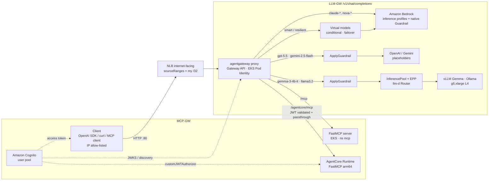
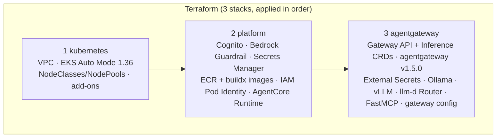

# agentgateway on Amazon EKS (Auto Mode) - LLM Gateway, MCP Gateway, Inference Routing and Bedrock Guardrails

[](LICENSE.md)
[](terraform/)
[](https://github.com/agentgateway/agentgateway)
[](https://docs.aws.amazon.com/eks/latest/userguide/automode.html)

Open-source, fully reproducible reference deployment of **[agentgateway](https://github.com/agentgateway/agentgateway)**
(the CNCF/AAIF agentic-AI data plane) on **Amazon EKS Auto Mode**, prioritizing AWS-native services:

| Capability | What is deployed | AWS services |
| --- | --- | --- |
| **LLM Gateway** | One OpenAI-compatible endpoint (`/v1/chat/completions`, `/v1/models`) routing by model name to Amazon Bedrock inference profiles (Claude Sonnet 4.5, Claude Haiku 4.5, Nova Pro, Nova Lite), virtual models (conditional + failover), and placeholders for OpenAI and Gemini | Amazon Bedrock, Secrets Manager |
| **MCP Gateway** | `/mcp` federates a FastMCP server running in EKS; `/agentcore/mcp` proxies an MCP server hosted on **Amazon Bedrock AgentCore Runtime** protected by **Cognito JWT** (demo user, self sign-up disabled) | AgentCore Runtime, Cognito, ECR |
| **Inference Routing** | Self-hosted **Ollama (`llama3.2:3b`)** and **Gemma 3 4B (vLLM)** on GPU nodes behind Gateway API `InferencePool`s with the llm-d Router endpoint picker | EKS Auto Mode GPU NodePool (g6.xlarge) |
| **Guardrails** | One **Amazon Bedrock Guardrail** (PII, denied topics, prompt attacks, profanity) enforced natively on Bedrock models and through the ApplyGuardrail API on every other model | Amazon Bedrock Guardrails |

Everything is Terraform + Helm (remote state in S3 with native locking). Naming standard: `agentgateway-santi-open`. Network exposure: **only your IP** (`/32`).

## Architecture


Source: [`assets/agentgateway-santi-open-architecture.drawio`](assets/agentgateway-santi-open-architecture.drawio)
(generated by [`assets/generate_architecture_drawio.py`](assets/generate_architecture_drawio.py)).

### Request flows





## Repository layout

```text
.
├── README.md · MANUAL_STEPS.md · TESTING_INSTRUCTIONS.md · LICENSE.md
├── assets/                          # draw.io diagram (+ generator) and DPI-400 PNG
├── apps/
│   ├── fastmcp-eks/                 # FastMCP server for EKS (Streamable HTTP, arm64)
│   └── agentcore-mcp/               # FastMCP server for AgentCore Runtime (MCP protocol, arm64)
├── docs/
│   ├── STEP_BY_STEP.md              # deploy / validate / destroy runbook + troubleshooting
│   ├── VALIDATION_SCRIPT_MANUAL.md  # manual of validate_solution_scripts.sh
│   └── adr/                         # 14 Architecture Decision Records
├── scripts/
│   ├── validate_solution_scripts.sh # didactic validator (menu + CLI): LLM-GW, MCP-GW, routing, guardrails, security
│   ├── deploy-all.sh · destroy-all.sh · get-gateway-url.sh · cognito-token.sh
│   └── tests/                       # individual suites + FastMCP test client
└── terraform/
    ├── kubernetes/                  # Stack 1: VPC + EKS Auto Mode + custom NodePools (local Helm chart)
    ├── platform/                    # Stack 2: AWS services around the cluster
    └── agentgateway/                # Stack 3: Helm releases (OCI + 7 local charts)
        └── charts/
            ├── gateway-api-crds/            # vendored Gateway API v1.6.0 (experimental channel)
            ├── inference-extension-crds/    # vendored Inference Extension v1.5.0
            ├── platform-secrets/            # ClusterSecretStore + ExternalSecrets
            ├── inference-ollama/            # Ollama on GPU
            ├── inference-gemma-vllm/        # vLLM + Gemma 3 4B on GPU
            ├── mcp-fastmcp/                 # MCP server Deployment/Service (appProtocol agentgateway.dev/mcp)
            └── agentgateway-config/         # Gateway, AgentgatewayParameters, Models, Backends, Routes, Policies
```

## Quickstart

```bash
# 0. prerequisites: terraform, aws cli v2, kubectl, helm, docker+buildx (colima), poetry, jq
poetry install --no-root
# 1. put YOUR public IP in terraform/kubernetes/terraform.tfvars (allowed_cidrs = ["x.x.x.x/32"])
# 2. deploy (≈35 min end to end)
./scripts/deploy-all.sh -auto-approve
# 3. validate (didactic menu; or: ./scripts/validate_solution_scripts.sh all)
./scripts/validate_solution_scripts.sh
# 4. destroy when done (≈USD 2.1/h while running)
./scripts/destroy-all.sh -auto-approve
```

Detailed runbook (deploy, validate, destroy, troubleshooting): [docs/STEP_BY_STEP.md](docs/STEP_BY_STEP.md).
Validator manual: [docs/VALIDATION_SCRIPT_MANUAL.md](docs/VALIDATION_SCRIPT_MANUAL.md). Expected results: [TESTING_INSTRUCTIONS.md](TESTING_INSTRUCTIONS.md).
Manual actions (only optional API keys): [MANUAL_STEPS.md](MANUAL_STEPS.md).

## Components and versions

| Component | Version | Source |
| --- | --- | --- |
| Amazon EKS Auto Mode | Kubernetes 1.36 (Bottlerocket, arm64 general pool, x86 GPU pool) | `terraform-aws-modules/eks` ~> 21.26 |
| agentgateway control plane + CRDs | v1.5.0 | `oci://cr.agentgateway.dev/charts` |
| Kubernetes Gateway API | v1.6.0 experimental channel | vendored |
| Gateway API Inference Extension | v1.5.0 | vendored |
| llm-d Router Gateway (InferencePool + EPP) | v0.9.0 | `oci://ghcr.io/llm-d/charts` |
| External Secrets Operator | 2.11.0 | `charts.external-secrets.io` |
| Ollama | 0.34.4 | Docker Hub |
| vLLM | v0.30.0 | Docker Hub |
| FastMCP (sample servers + test client) | >= 2.12 | PyPI |
| Terraform | >= 1.10 (tested 1.16.4), providers aws ~> 6.0, helm ~> 3.0 | `hashicorp/tap` |
| Terraform state | S3 `terraform-santigrc-430118815432` · keys `agentgateway-santi-open/<stack>/terraform.tfstate` · native S3 locking | ADR-002 |

## Model catalog (client-facing names)

| Name | Type | Target | Guardrail |
| --- | --- | --- | --- |
| `claude-sonnet-4-5` | Bedrock | `us.anthropic.claude-sonnet-4-5-20250929-v1:0` | native |
| `claude-haiku-4-5` | Bedrock | `global.anthropic.claude-haiku-4-5-20251001-v1:0` | native |
| `nova-pro` / `nova-lite` | Bedrock | `us.amazon.nova-pro-v1:0` / `us.amazon.nova-lite-v1:0` | native |
| `smart` | virtual conditional | `x-model-tier: premium` -> Claude Sonnet 4.5, else Nova Lite | inherited |
| `resilient` | virtual failover | Claude Sonnet 4.5 -> Nova Pro | inherited |
| `gpt-5.5` | OpenAI placeholder | key from Secrets Manager | ApplyGuardrail |
| `gemini-2.5-flash` | Gemini placeholder | key from Secrets Manager | ApplyGuardrail |
| `gemma-3-4b-it` | InferencePool `gemma` | vLLM on g6.xlarge | ApplyGuardrail |
| `llama3.2` | InferencePool `ollama` | Ollama `llama3.2:3b` on g6.xlarge | ApplyGuardrail |

## Security posture

- EKS API endpoint public access limited to `allowed_cidrs` (validation forbids `0.0.0.0/0`), private endpoint on.
- NLB `loadBalancerSourceRanges` = your `/32`; nodes in private subnets; egress via NAT; VPC flow logs.
- No static AWS credentials: EKS Pod Identity roles with least-privilege policies (Bedrock invoke on
  foundation models/inference profiles, `ApplyGuardrail` on one guardrail, `InvokeAgentRuntime` on one runtime).
- Third-party keys only in Secrets Manager (placeholders) synced by External Secrets; never in git or state.
- Cognito: admin-only user creation, strong password policy, access tokens validated by agentgateway (issuer,
  JWKS, `client_id`, `token_use`) and again by AgentCore.
- Kubernetes secrets envelope-encrypted with KMS; control-plane audit logs on; containers run as non-root,
  read-only root filesystem, no capabilities.

## Cost (us-east-1, on-demand, approximate)

| Item | USD/hour |
| --- | --- |
| 2x g6.xlarge (Ollama + Gemma) | 1.61 |
| 2x m7g.large (general) + system node | ~0.25 |
| EKS control plane | 0.10 |
| NAT gateway + Auto Mode fee + NLB | ~0.15 |
| **Total** | **~2.1 (~50/day)** |

Set `enable_inference_routing = false` to drop the GPU nodes when you only need Bedrock/MCP.

## Decisions

All decisions are documented as ADRs in [docs/adr](docs/adr/README.md): EKS Auto Mode, three-stack
Terraform layout, agentgateway Kubernetes mode with the model-centric API, medium-tier instances,
IP allow-list exposure, Pod Identity, guardrails strategy, inference routing, Gemma weights source,
secrets management, AgentCore JWT passthrough, image pipeline, observability and the model catalog.

## Validation results

Run executed on 2026-09-27 from the allow-listed IP against
`agentgateway-santi-open-nlb-<hash>.elb.us-east-1.amazonaws.com` (HTTP :80). Full commands in
[TESTING_INSTRUCTIONS.md](TESTING_INSTRUCTIONS.md); raw suites live in `scripts/tests/`.

| # | Capability | Check | Result |
| --- | --- | --- | --- |
| 1 | LLM-GW | `/v1/models` lists the 10 client-facing models | PASS |
| 2 | LLM-GW | Bedrock routing `claude-sonnet-4-5`, `claude-haiku-4-5`, `nova-pro`, `nova-lite` (Pod Identity, no keys) | PASS - OpenAI-shaped responses with token usage |
| 3 | LLM-GW | Virtual `smart`: default -> `us.amazon.nova-lite-v1:0`; header `x-model-tier: premium` -> `us.anthropic.claude-sonnet-4-5-20250929-v1:0` | PASS |
| 4 | LLM-GW | Virtual `resilient` (failover) served by priority-0 target | PASS |
| 5 | LLM-GW | SSE streaming through the gateway | PASS |
| 6 | LLM-GW | Placeholders `gpt-5.5` / `gemini-2.5-flash` reach the provider and fail with `invalid_api_key` (placeholder value) | PASS (expected until MANUAL_STEPS) |
| 7 | Guardrails | Bedrock-native: PII email, denied topic, prompt attack, profanity, custom word blocked on Claude Haiku 4.5 and Nova Lite; benign control passes | PASS |
| 8 | Guardrails | ApplyGuardrail prompt guard on `gemma-3-4b-it`, `llama3.2` and `gpt-5.5`: HTTP 403 with custom message, before any upstream call | PASS |
| 9 | MCP-GW | `/mcp` -> FastMCP on EKS: initialize, tools/list (4 tools), `eks_add` = 42, `eks_runtime_info` shows pod on Graviton (`aarch64`) | PASS |
| 10 | MCP-GW | `/agentcore/mcp` without token -> 401 at the gateway | PASS |
| 11 | MCP-GW | `/agentcore/mcp` with Cognito access token (santigrc@amazon.com) -> AgentCore Runtime tools, `agentcore_multiply` = 42, `agentcore_runtime_info` shows `aarch64` | PASS |
| 12 | Inference routing | `gemma-3-4b-it` -> InferencePool `gemma` (vLLM v0.30.0 on g6.xlarge) | PASS |
| 13 | Inference routing | `llama3.2` -> InferencePool `ollama` (Ollama 0.34.4 on g6.xlarge); EPP logs show endpoint selection per request | PASS |
| 14 | Security | EKS `publicAccessCidrs = ["<my-ip>/32"]`; NLB security group ingress = `tcp/80` from `<my-ip>/32` only | PASS |
| 15 | Security | No AWS key Secrets in the cluster; Cognito `SignUp is not permitted for this user pool`; AgentCore direct call without JWT -> 401 | PASS |
| 16 | IaC | `terraform plan` on the three stacks after deployment | No changes (idempotent) |

Issues found and fixed during the run (kept as lessons in the ADRs and code comments):

- EKS Auto Mode rejects NodePools whose `expireAfter + terminationGracePeriod` exceeds 21 days.
- ECR tag values do not accept parentheses.
- Kubernetes service links injected `FASTMCP_PORT=tcp://...` into the FastMCP pod (FastMCP reads
  `FASTMCP_*` settings); fixed with `enableServiceLinks: false`.
- Helm release names must be unique per namespace: the llm-d router release name becomes the
  `InferencePool` name (`ollama`, `gemma`), so the model-server releases are `ollama-server` and `gemma-server`.

## Acknowledgements

- [agentgateway](https://github.com/agentgateway/agentgateway) (Apache 2.0) by Solo.io and the Agentic AI Foundation.
- [llm-d Router](https://github.com/llm-d/llm-d-router), [Gateway API Inference Extension](https://gateway-api-inference-extension.sigs.k8s.io/).
- Gemma weights are subject to the [Gemma Terms of Use](https://ai.google.dev/gemma/terms).

# LICENSE

Copyright 2026 Santiago Garcia Arango

Licensed under the Apache License, Version 2.0. See [LICENSE.md](LICENSE.md).
