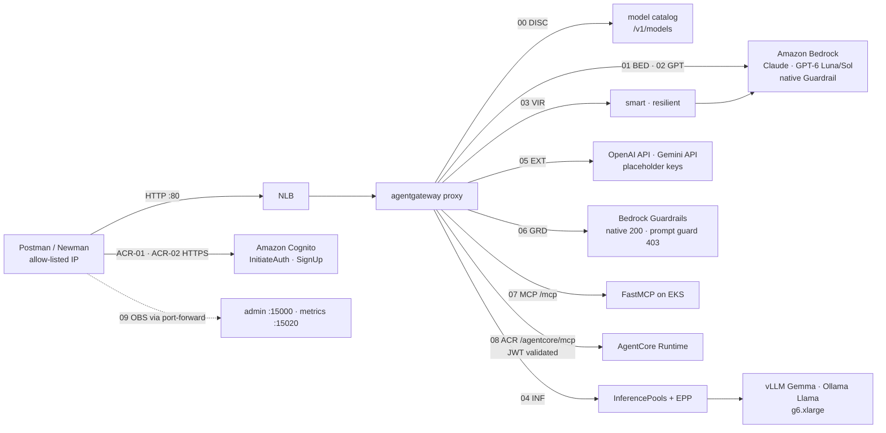
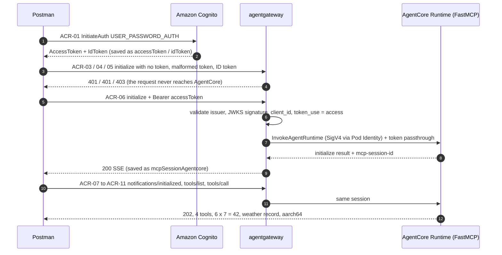

# Postman collection: agentgateway-santi-open

API tour **and** automated test suite for this deployment: **65 requests in 10 folders** covering the LLM
Gateway (Amazon Bedrock Claude and OpenAI GPT-6, virtual models, external placeholders), inference routing
to self-hosted GPU models, Amazon Bedrock Guardrails and the MCP Gateway (FastMCP on EKS and AgentCore
Runtime with Cognito JWT). Every request documents **what it validates**, the **flow** and the **expected
result**, carries `pm.test` assertions and a **saved example** captured from a live run.

Last run (2026-11-26, Newman 6.2.3, from an allow-listed IP): **65 requests, 295 assertions, 0 failures** in 44.6 s.

## Files

| File | Purpose |
| --- | --- |
| `agentgateway-santi-open.postman_collection.json` | The collection (schema v2.1). Generated, do not edit by hand |
| `agentgateway-santi-open.postman_environment.json` | Environment template (placeholders, no secrets) |
| `agentgateway-santi-open.local.postman_environment.json` | Your live environment, written by `../scripts/postman-env.sh` (git-ignored) |
| `generate_postman_collection.py` | Source of truth of requests, descriptions and tests; regenerates both JSON files |
| `../scripts/tests/test-postman.sh` | Headless run with Newman (`npx newman@6.2.3`, no global install) |

## Map of the collection



The folders 07 MCP and 08 ACR are **stateful**: the test scripts store the session ids and tokens in
collection variables, so run them top to bottom (the Collection Runner does it in order).



## Naming convention

`<AREA>-<NN> · <target> · <scenario> → <expected>`, for example
`GPT-03 · gpt-6-luna · temperature + top_p dropped by the gateway → 200`.

| AREA | Folder | Requests | What it covers |
| --- | --- | --- | --- |
| DISC | 00 Discovery | 2 | `/v1/models` (10 names), unknown model (404) |
| BED | 01 Bedrock Claude | 6 | chat, Spanish system prompt, SSE, tool calling, tool result round trip, `max_tokens` → `length` |
| GPT | 02 Bedrock OpenAI GPT-6 | 7 | Luna and Sol, `temperature`/`top_p` dropped, tools, round trip, SSE, reasoning effort `none` |
| VIR | 03 Virtual models | 4 | `smart` default and premium tier, inherited `dropParams`, `resilient` failover |
| INF | 04 Inference routing | 5 | Gemma on vLLM, Llama on Ollama, tool calling on Ollama, vLLM without tool parser (400), SSE |
| EXT | 05 External placeholders | 2 | OpenAI API and Gemini API with the placeholder key (401) |
| GRD | 06 Guardrails | 12 | native blocks (PII, topic, prompt attack, profanity, custom word, cards), virtual inheritance, prompt guard 403 |
| MCP | 07 MCP on EKS | 12 | initialize, handshake, tools, resources, tool error, missing session (400), DELETE (202) |
| ACR | 08 AgentCore + Cognito | 12 | login, self sign-up disabled, JWT negative tests (401/401/403), tools on AgentCore |
| OBS | 09 Observability | 3 | admin UI, `config_dump`, Prometheus GenAI token metrics (port-forward) |

`NN` is the execution order inside the folder. Variables are camelCase; the runtime ones
(`accessToken`, `idToken`, `mcpSessionEks`, `mcpSessionAgentcore`) are written by test scripts only.

## Quick start in the Postman app

1. Deploy (`./scripts/deploy-all.sh -auto-approve`) and run `./scripts/postman-env.sh`.
2. Postman → **Import** both `agentgateway-santi-open.postman_collection.json` and
   `agentgateway-santi-open.local.postman_environment.json`.
3. Select the environment **agentgateway-santi-open (local, live)** and type the demo password in the
   secret variable `cognitoPassword` (current value only, it never leaves your machine).
4. Open any request: the documentation pane explains it, **Send** runs it, **Test Results** shows the
   assertions and **Examples** shows the response captured from the live run.
5. **Run collection** (Collection Runner) for a folder or everything. Folder 09 needs `./scripts/ui.sh` running.

## Headless with Newman

```bash
./scripts/tests/test-postman.sh                                   # folders 00-08
WITH_OBSERVABILITY=1 ./scripts/tests/test-postman.sh              # + 09 OBS (opens the port-forward itself)
POSTMAN_FOLDERS="02 · LLM-GW · Bedrock OpenAI GPT-6 (GPT),06 · Guardrails · native + prompt guard (GRD)" \
  ./scripts/tests/test-postman.sh                                 # only some folders (comma separated)
```

The script regenerates the local environment, injects the demo password into a private temp copy
(`COGNITO_DEMO_PASSWORD`, `TF_VAR_cognito_demo_user_password` or `terraform/platform/secrets.auto.tfvars`)
and exits with Newman's status code, so it fits CI as well.

## Expected results at a glance

| Scenario | Status | Key assertion |
| --- | --- | --- |
| Bedrock model (Claude, GPT-6) | 200 | `object = chat.completion`, `model` = the Bedrock profile id, token usage |
| Streaming | 200 | `text/event-stream`, `chat.completion.chunk`, usage chunk, `data: [DONE]` |
| Tool calling | 200 | `finish_reason = tool_calls`, `consulta_saldo` with `{"cuenta": "ahorros-1234"}` |
| Native guardrail block | **200** | `finish_reason = content_filter`, blocked message as assistant content |
| Prompt guard block (self-hosted, placeholders) | **403** | `Request blocked by Amazon Bedrock Guardrails (prompt guard)` |
| Placeholder provider | 401 | `invalid_api_key` (OpenAI) / `authentication_error` (Gemini); 200 once a real key is set |
| Unknown model | 404 | `model_not_found` |
| MCP request without session | 400 | `session header is required` |
| AgentCore without token / malformed / ID token | 401 / 401 / 403 | gateway rejects before AgentCore |

## Gotchas the tests capture

- **GPT-6 rejects `temperature` and `top_p`** (`ValidationException`): GPT-03 and VIR-03 send them on
  purpose and pass because the gateway nulls them (`dropParams`).
- **GPT-6 redacted reasoning**: GPT-07 sends a multi-step prompt; it only works because
  `openaiReasoningEffort: none` avoids the `redactedContent` block that agentgateway v1.5.0 cannot parse.
- **Prompt guard false positives**: on self-hosted models the guardrail sees the raw text, and
  `PROMPT_ATTACK` (MEDIUM) blocks instruction-shaped prompts such as "Who are you? Answer in one sentence."
  (403). The INF requests use plain questions.
- **vLLM has no tool parser**: INF-04 documents the 400 when `tools` are sent to Gemma.
- **AgentCore DELETE returns 404**: the AgentCore-hosted FastMCP runs `stateless_http=True` (ACR-12).
- **Native guardrail blocks are HTTP 200**: assert `finish_reason = content_filter`, not the status code.

## Regenerate the collection or refresh the examples

```bash
.venv/bin/python postman/generate_postman_collection.py      # after editing requests/tests (keeps saved examples)
POSTMAN_REPORT=postman/.newman/report.json WITH_OBSERVABILITY=1 ./scripts/tests/test-postman.sh
.venv/bin/python postman/generate_postman_collection.py --examples postman/.newman/report.json
rm -rf postman/.newman                                        # the report contains Cognito tokens
```

`--examples` keeps only `content-type`, `mcp-session-id` (redacted) and `www-authenticate` headers,
replaces Cognito tokens with `<redacted JWT>`, truncates long bodies and filters the Prometheus output to
the GenAI token metric.

## Security notes

- No secret is committed: the password is a `secret` environment variable, tokens and session ids only
  live in runtime collection variables, saved examples are sanitized and Newman reports are git-ignored.
- The gateway answers only to the allow-listed `/32`s (`terraform/kubernetes/terraform.tfvars`). From any
  other IP every request times out; see the troubleshooting table in [docs/STEP_BY_STEP.md](../docs/STEP_BY_STEP.md).
- Every LLM request is billed by Amazon Bedrock (a full run costs a few cents); the GPU folders need the
  inference NodePool running (`enable_inference_routing = true`).

# LICENSE

Copyright 2026 Santiago Garcia Arango

Licensed under the Apache License, Version 2.0. See [LICENSE.md](../LICENSE.md).
